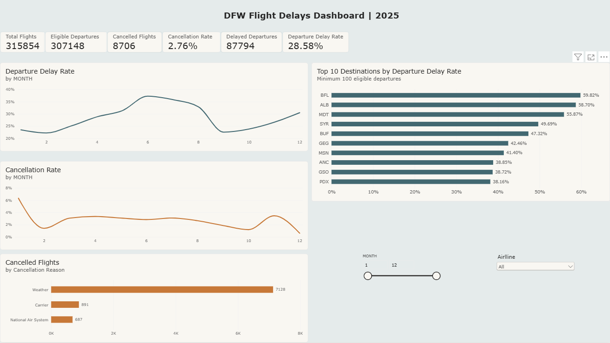

# DFW Flight Delays Dashboard | 2025

## Project Overview

This project analyzes 2025 flight data for Dallas/Fort Worth International Airport (DFW). I used SQL and Power BI to explore departure delays, cancellations, monthly trends, and destinations with the highest departure delay rates.
The interactive deashboard allows users to filter the results by month and airline.

## Tools

- SQL and DB Browser for SQLite
- Power Query
- DAX
- Power BI

## Data Source

The data comes from the U.S. Bureau of Transportation Statistics (BTS), TranStats:
[Reporting Carrier On-Time Performance — download page](https://www.transtats.bts.gov/DL_SelectFields.aspx?gnoyr_VQ=FGJ&QO_fu146_anzr=b0-gvzr)

For this project, I analyzed 2025 flights departing from DFW.

## Key Findings

- The dataset includes **315,854 flights**, of which **307,148** were elgible departures.
- **87,794 departures** were delayed by at least 15 minutes, resulting in a **28.58% departure delay rate**.
- **8,706 flights** were cancelled, a **2.76% cancellation rate**.
- Weather was the leading reported cancellation reason, with **7,128 cancelled flights**.
- BFL had the highest departure delay rate in the destination ranking, at **59.82%**.

## Dashboard Features
- Monthly departure delay and cancellation trends
- Cancelled flights by reported reason
- Top 10 destinations by departure delay rate
- Filters for month and operating airline
- Key performance indicators for flights, delays, and canellations

The destination ranking includes only destinations with at least **100 eligible departures** in the selected filter context.

## Metric Definitions
- **Eligible departures:** flights that were not cancelled.
- **Departure delay rate:** delayed departures divided by eligible departures.
- **Cancellation rate:** cancelled flights divided by total flights.
- **Delayed departure:** a departure delayed by at least 15 minutes.

## Opening the Power BI Report
Download the '.pbix' file and open it in Power BI Desktop.
The report contains the data saved with the file.

To refresh the data, you may need to obtain and prepare the source data, then update the file path in Power Query to match its location on your computer.
